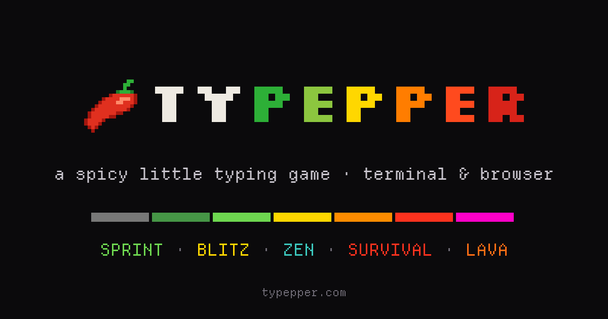

<p align="center">
  <a href="https://typepper.com"></a>
</p>

## Play

**In your browser:** https://typepper.com/

**In your terminal** (macOS, Linux):

```sh
curl -LsSf https://typepper.com/install.sh | sh
```

Windows (PowerShell):

```powershell
powershell -ExecutionPolicy Bypass -c "irm https://github.com/leodiegues/typepper/releases/latest/download/typepper-installer.ps1 | iex"
```

Or build it yourself: `cargo install --git https://github.com/leodiegues/typepper`

## License

typepper is free software: you can redistribute it and/or modify it under
the terms of the [GNU General Public License](LICENSE) as published by the
Free Software Foundation, either version 3 of the License, or (at your
option) any later version.

The bundled [Departure Mono](https://departuremono.com) font is © Helena
Zhang, under the [SIL Open Font License 1.1](assets/fonts/DepartureMono-LICENSE.txt).
